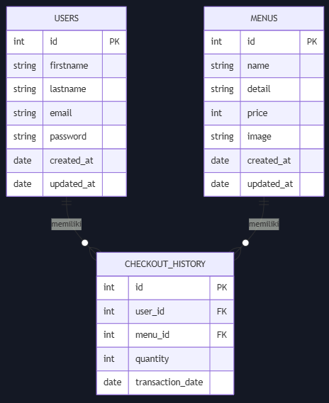
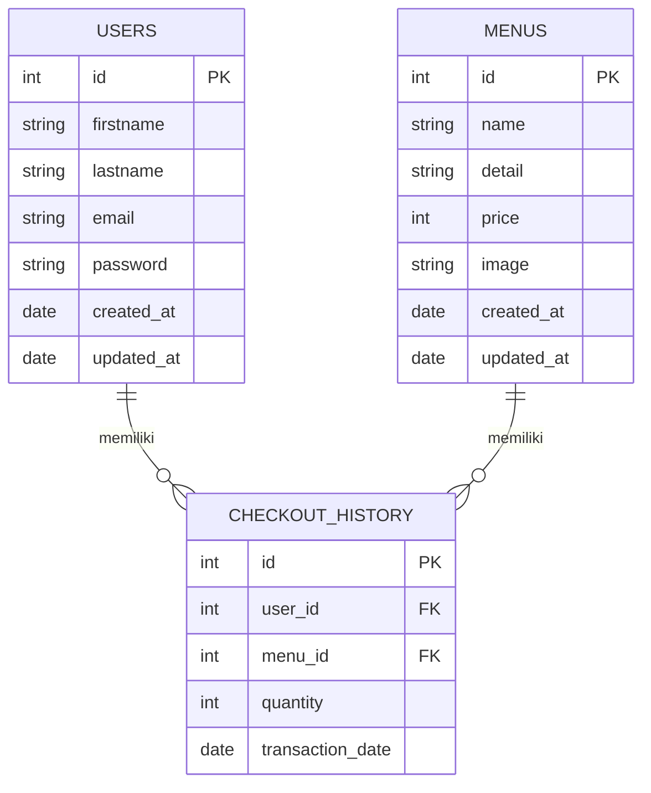
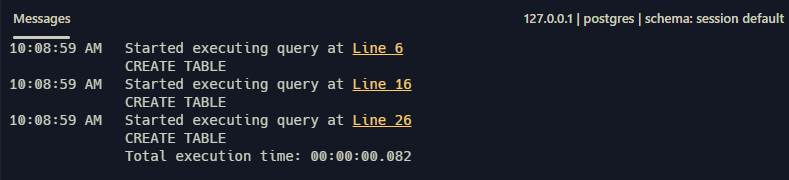
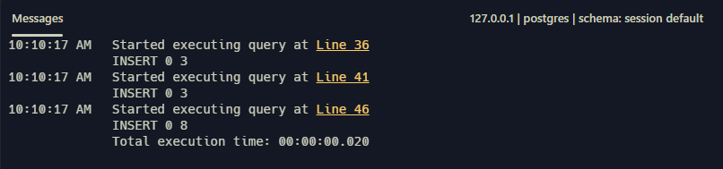
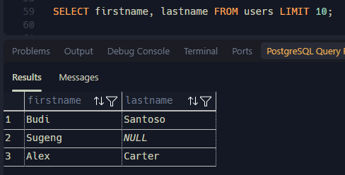
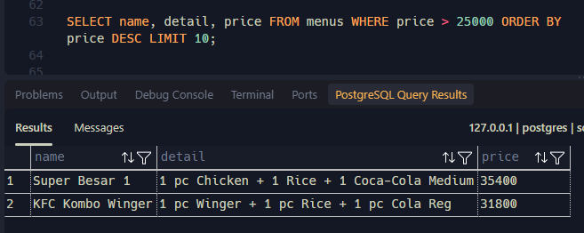
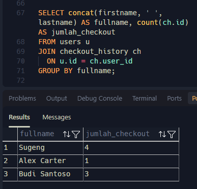
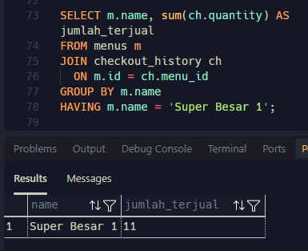
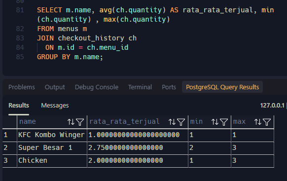

# ERD KFC

## Penjelasan Database
Database KFC merupakan tempat penyimpanan data restoran KFC yang berisikan tabel user atau pembeli, tabel menu makanan & minuman KFC, serta tabel checkout history yang berisikan riwayat pembelian di KFC oleh pembeli.

## Screenshot & Tampilan ERD (mermaid)
### 1. Screenshot ERD
<p align="center">

</p>

<hr/>

### 2. ERD (live mermaid)


## Query SQL 
```query
DROP TABLE IF EXISTS users CASCADE;
DROP TABLE IF EXISTS menus CASCADE;
DROP TABLE IF EXISTS checkout_history CASCADE;

-- DDL =================================
CREATE TABLE users (
  id INTEGER GENERATED ALWAYS AS IDENTITY PRIMARY KEY,
  firstname VARCHAR(80) NOT NULL,
  lastname VARCHAR(80),
  email VARCHAR(70) NOT NULL UNIQUE,
  password VARCHAR(255) NOT NULL,
  created_at TIMESTAMPTZ DEFAULT NOW(),
  updated_at TIMESTAMPTZ
);

CREATE TABLE menus (
  id INTEGER GENERATED ALWAYS AS IDENTITY PRIMARY KEY,
  name VARCHAR(100) NOT NULL UNIQUE,
  detail VARCHAR(200),
  price INTEGER CHECK(price > 0),
  image VARCHAR(255),
  created_at TIMESTAMPTZ DEFAULT NOW(),
  updated_at TIMESTAMPTZ
);

CREATE TABLE checkout_history (
  id INTEGER GENERATED ALWAYS AS IDENTITY PRIMARY KEY,
  quantity INTEGER DEFAULT 1,
  user_id INTEGER,
  menu_id INTEGER,
  FOREIGN KEY (user_id) REFERENCES users (id),
  FOREIGN KEY (menu_id) REFERENCES menus (id)
);

-- DML =================================
INSERT INTO users (firstname, lastname, email, password) VALUES
('Budi', 'Santoso', 'budi@gmail.com', '12345'),
('Sugeng', NULL, 'sugng@gmail.com', 'sgngn321'),
('Alex', 'Carter', 'alek@yahoo.com', 'alxcrtr54');

INSERT INTO menus (name, detail, price, image) VALUES
('Chicken', NULL, 21800, 'https://order.kfcku.co.id/_next/image?url=https%3A%2F%2Ffirebasestorage.googleapis.com%2Fv0%2Fb%2Fkfcjv-production.appspot.com%2Fo%2FMenuImages%252F4838.jpg%3Falt%3Dmedia&w=128&q=75'),
('Super Besar 1', '1 pc Chicken + 1 Rice + 1 Coca-Cola Medium', 35400, 'https://order.kfcku.co.id/_next/image?url=https%3A%2F%2Ffirebasestorage.googleapis.com%2Fv0%2Fb%2Fkfcjv-production.appspot.com%2Fo%2FMenuImages%252F4839.jpg%3Falt%3Dmedia&w=128&q=75'),
('KFC Kombo Winger', '1 pc Winger + 1 pc Rice + 1 pc Cola Reg', 31800, 'https://order.kfcku.co.id/_next/image?url=https%3A%2F%2Ffirebasestorage.googleapis.com%2Fv0%2Fb%2Fkfcjv-production.appspot.com%2Fo%2FMenuImages%252F4850c.jpg%3Falt%3Dmedia&w=128&q=75');

INSERT INTO checkout_history (quantity, user_id, menu_id) VALUES
(2, 1, 1),
(3, 3, 2),
(1, 2, 3),
(3, 1, 2),
(1, 1, 1),
(3, 2, 1),
(3, 2, 2),
(2, 2, 2);

-- =====================================

SELECT firstname, lastname FROM users LIMIT 10;

SELECT name, detail, price FROM menus WHERE price > 25000 ORDER BY price DESC LIMIT 10;

SELECT concat(firstname, ' ', lastname) AS fullname, count(ch.id) AS jumlah_checkout
FROM users u
JOIN checkout_history ch
  ON u.id = ch.user_id
GROUP BY fullname;

SELECT m.name, sum(ch.quantity) AS jumlah_terjual
FROM menus m
JOIN checkout_history ch
  ON m.id = ch.menu_id
GROUP BY m.name
HAVING m.name = 'Super Besar 1';

SELECT m.name, avg(ch.quantity) AS rata_rata_terjual, min(ch.quantity) , max(ch.quantity)
FROM menus m
JOIN checkout_history ch
  ON m.id = ch.menu_id
GROUP BY m.name;
```

## Hasil Eksekusi Query SQL
### 1. DDL
<p align="center">

</p>

<hr/>

### 2. DML INSERT & SELECT, DLL.
<p align="center" style="margin-bottom: 20px;">

</p>
<p align="center" style="margin-bottom: 20px;">

</p>
<p align="center" style="margin-bottom: 20px;">

</p>
<p align="center" style="margin-bottom: 20px;">

</p>
<p align="center" style="margin-bottom: 20px;">

</p>
<p align="center">

</p>
